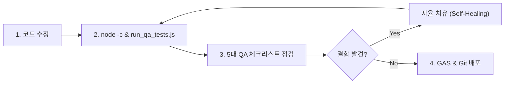

# Code Review & QA Verification Pipeline

이 스킬은 코드 작성 또는 수정 직후, 배포 및 사용자 보고 전에 반드시 수행하는 **실효성 중심의 경량 QA 및 코드리뷰 파이프라인**입니다.

---

## 🎯 핵심 원칙 (QA 파이프라인 경량화 및 실효성 유지)
- **무의미한 문자열(`.includes`) 테스트 남발 금지**: 일상적인 UI/문구 수정 시마다 `scripts/run_qa_tests.js`에 단순 텍스트 존재 여부나 버전 번호 정규식을 덧붙이지 않습니다.
- **실제 런타임 & AST 구문 검증 중심**: `node -c 현장서식.js && node scripts/run_qa_tests.js` 실행(약 0.13초)을 통해 서버 코드, PC/모바일 대시보드 내장 `<script>` AST 문법, 그리고 174개 핵심 비즈니스 로직의 런타임 동작을 검증합니다.

---

## 📋 필수 검증 체크리스트

### 1. 정적 구문 및 클라이언트 `<script>` AST 검증
- `node -c 현장서식.js && node scripts/run_qa_tests.js`
- `buildSidebarDashboardHtml('pc')` 및 `buildSidebarDashboardHtml('mobile')`이 생성하는 HTML 내 `<script>` 블록에 따옴표 이스케이프 누락이나 `SyntaxError`가 없는지 자동 검증합니다.
- `index.html`과 `docs/index.html`이 100% 일치하는지 검증합니다.

### 2. 5대 핵심 QA 체크리스트
1. **경계값 및 오입력**: `null`, `undefined`, 빈 문자열(`""`), 날짜/시간 경계값(`00:00`, `23:59`, 윤년, 월말) 방어
2. **동시성 및 상태 일관성**: 낙관적 업데이트(`pendingOptimisticTasks`) 및 서버 캐시(`CacheService`) 무효화 정합성
3. **API 할당량 및 속도 최적화**: 불필요한 시트 I/O 생략(`needSheet` 분기, 단일 범위 읽기/쓰기)
4. **데이터 무결성**: 정렬·행 이동 후에도 스마트 행 번호 추적(`targetId` / 현장명+공종명 매칭)으로 엉뚱한 행 덮어쓰기 방지
5. **UI 및 서식 보호**: 시트 데이터 유효성 검사(`02_거래처`, `03_구성원`, `04_공종`) 및 조건부 서식 유지

### 3. 자율 치유 (Self-Healing)
- 검증 과정에서 구문 오류나 테스트 실패가 발생하면 사용자에게 묻지 않고 즉시 원인을 수정한 뒤 재검증을 통과시킵니다.
