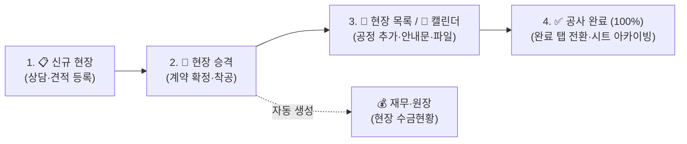

# 🏢 우성아이디 통합 현장·재무 대시보드 실무 사용설명서

> **대상 시스템**: 우성아이디 통합 대시보드 (`https://kimver2.github.io/woosung-id/`)  
> **구성**:  
> - **Part 1.** 현장 관리 실무 흐름 (신규 상담 ➔ 계약·승격 ➔ 공정 관리 ➔ 공사 완료·아카이빙)  
> - **Part 2.** 재무·원장 실무 매뉴얼 (수금현황 ➔ 월별 비용마감 ➔ 고정비 관리 ➔ 월간집계·마진 분석)  
> - **Part 3.** 마스터 기준정보 설정 및 관리자 도구

---

## 📘 Part 1. 현장 관리 실무 흐름 (상담부터 공사 완료까지)

---

### Step 1. 신규 문의 접수 및 상담 관리 (`📋 신규 현장` 탭)
고객에게 처음 인테리어 문의가 들어왔을 때 시작하는 단계입니다.

1. 상단 메뉴에서 **`📋 신규 현장`** 탭으로 이동한 뒤 우측 상단의 **`[➕ 신규 견적 등록]`** 버튼을 누릅니다.
2. **기본 정보 입력**:
   - **현장명**(예: `신대방우성 16동 902호`), **문의일**, **공사 범위**(전체공사 / 부분공사 등), **고객명·연락처**, **담당자**를 입력합니다.
   - **일정 및 금액**: `1차 상담일`, `견적서 발송 예정일`, `예상 착공일`, `예상 견적금액`을 입력하면 우측 타임라인과 캘린더에 상담 일정이 자동으로 표시됩니다.
3. **진행 상태 변경**:
   - 상담이 진행됨에 따라 상태를 `신규 문의` ➔ `1차 상담 완료` ➔ `견적서 발송` ➔ `피드백 대기` 순으로 변경하며 히스토리를 관리합니다.

---

### Step 2. 계약 성사 및 실제 공사 현장으로 전환 (`🚀 진행 현장으로 승격`)
고객과 계약이 성사되어 실제 공사를 시작할 때, 데이터를 다시 입력할 필요 없이 **진행 현장으로 승격**합니다.

1. `📋 신규 현장`에서 계약이 확정된 현장을 선택하고 우측 상단의 **`[🚀 진행 현장으로 승격]`** 버튼을 클릭합니다.
2. **승격 팝업 입력**:
   - **확정 계약금액**과 **실제 공사 기간(착공일 ~ 준공일)**을 확인·입력합니다.
   - 하단의 **`☑ 재무DB [수금현황] 자동 등록`** 체크박스가 기본으로 체크되어 있습니다.
3. **승격 완료 시 자동 처리되는 3가지**:
   - `📋 신규 현장`에서는 **`계약 성사`** 상태로 완료 처리됩니다.
   - `🏢 현장 목록`과 `📅 캘린더`에 정식 **진행 현장**으로 등록됩니다.
   - `💰 재무·원장`의 **`💰 현장 수금현황`**에 해당 현장의 계약금액·고객명·담당자·공사기간이 **자동으로 생성**됩니다.

---

### Step 3. 착공 준비 및 세부 공정 추가·진행 (`🏢 현장 목록` & `📅 캘린더`)
실제 공사가 진행되는 동안 현장의 모든 정보와 일정을 관리하는 단계입니다.

1. **현장 기본정보 및 착공 필수 체크 등록 (`🏢 현장 목록`)**
   - 상단 캐러셀(또는 좌측 목록)에서 현장을 선택하고 우측의 **`[✏️ 현장정보 수정]`**을 클릭합니다.
   - **현장 주소**, **🔑 공동현관·도어락 비밀번호**, **관리사무소 연락처**, **특이사항/주차 메모**, **📂 구글 드라이브 폴더 링크**를 저장합니다.
   - **🛡️ 착공 필수 체크 3종**(`입주민 동의서` · `승강기 보양` · `관리실 신고`) 완료 여부를 체크해 두면 상단 배지로 한눈에 표시됩니다.
   - **`[📤 파일 업로드]`** 버튼을 누르면 휴대폰 카메라로 찍은 현장 사진(`📷 사진 촬영`)이나 도면 파일(`📁 파일 선택`)을 해당 현장의 구글 드라이브 폴더로 바로 업로드할 수 있습니다.

2. **세부 공정(철거·설비·목공·타일 등) 추가**
   - 현장 상세 화면 우측 상단의 **`[➕ 새 공정 추가]`** (또는 좌측 상단 **`[➕ 새 일정 등록]`**) 버튼을 클릭합니다.
   - **공종 선택**(초성/한글 검색 가능), **일정**(단일 날짜 / 연속 기간 / 시작·종료 시간), **담당자(1·2담당자)**, **협력업체(반장님)**, **메모**를 입력하고 저장합니다.
   - **단건 및 A/S 일정 등록**: 본공사가 아닌 단발성 작업이나 사후 보수는 일정 등록 모달 상단 구분에서 **`단건`** 또는 **`AS`**를 선택해 등록하면 각각 `[단건]`, `[AS]` 배지가 붙어 별도 시트(`단건`, `AS`)로 깔끔하게 관리됩니다.

3. **협력업체(반장님) 작업 안내문 발송**
   - 현장 상세의 **`[📋 안내문 확인]`** 버튼(또는 공정 체크 후 `[📋 선택 안내문 생성]`)을 누르면, **현장 주소 + 도어락 비밀번호 + 해당 반장님 공정 일정 + 담당 소장 연락처**가 자동으로 조합된 안내문이 생성됩니다.
   - **`[📋 안내문 복사]`**를 눌러 카카오톡으로 반장님께 바로 전달할 수 있습니다.

4. **일정 변경 및 진행 상태 체크**
   - **드래그 이동**: `📅 캘린더` 탭에서 공정 막대를 마우스로 끌어 다른 날짜로 놓으면(기존 설정된 시간 정보 유지) 날짜가 즉시 변경됩니다.
   - **연쇄 이동**: 앞 공정이 밀렸을 때 공정 수정 모달에서 날짜 변경 시 **`후속 공정 연쇄 이동`**을 체크하면 뒤쪽 공정 날짜들도 일괄 조정할 수 있습니다.
   - **상태 변경**: 공정이 끝날 때마다 상태를 `예정` ➔ `진행중` ➔ **`완료`**로 변경하면 현장의 전체 **진행률(%)**이 실시간으로 올라갑니다. (완료 전 날짜가 지난 공정은 자동으로 **`⚠️ 지연`** 경고가 뜹니다.)

---

### Step 4. 현장 완료 및 시트 아카이빙 (`100% 완료` ➔ `완료·보관`)

1. **자동 완료 현장 전환**:
   - 현장의 모든 유효 공정이 **`완료`** 처리되어 진행률이 **100%**가 되면, 해당 현장은 자동으로 `🏗️ 진행 현장` 목록에서 빠져 **`✅ 완료·보관 포함`** 탭으로 이동합니다.
   - 완료된 현장 카드 하단에는 다음 공정 대신 전체 공사 기간(`기간 : 2026.10.01 ~ 2026.11.16`)이 자동으로 표시되며 최근 완료일 순으로 정렬됩니다.
2. **스프레드시트 아카이빙 (정리)**:
   - 상단 **`⚙️ 설정`** ➔ **`🛠️ 데이터 관리`** 탭에서 **`[📦 완료 현장 시트 아카이빙]`**의 `[아카이브 실행]`을 누르면, 모든 공정이 끝난 현장 블록들을 `02_현장데이터` 시트에서 `99_완료현장` 시트로 안전하게 이동시켜 시트 속도를 가볍게 유지해 줍니다.

---
---

## 💰 Part 2. 재무·원장 (`💰 재무·원장` 탭) 입력 및 활용 매뉴얼

> **접근 권한**: `조항만` 또는 `admin` 계정으로 로그인했을 때 상단(PC) 및 하단(모바일)에 **`💰 재무·원장`** 탭이 표시됩니다.  
> - **PC 화면**: `📋 신규 현장` 옆에 **`🤝 거래처`** 탭과 **`💰 재무·원장`** 탭이 나란히 둘 다 노출됩니다.  
> - **모바일 화면**: 하단 탭 바에 **`💰 재무`** 탭이 노출됩니다 (일반 직원은 PC·모바일 모두 `🤝 거래처` 탭만 노출).

재무·원장은 4개의 서브탭(**① 현장 수금현황 ➔ ② 월별 비용마감 ➔ ③ 고정비 관리 ➔ ④ 월간집계**)으로 구성되어 있습니다.

---

### 1. `💰 현장 수금현황` — 고객에게 받을 돈(매출·미수금) 관리
현장별 총 계약금액과 단계별 입금 내역(계약금·착수금·중도금·잔금), 남은 미수금을 관리합니다.

1. **현장 등록 방법**:
   - **자동 등록**: 앞서 `📋 신규 현장`에서 `[🚀 진행 현장으로 승격]`을 하면 자동으로 행이 추가됩니다.
   - **직접 등록**: 우측 상단 **`[➕ 현장 수금 추가]`** 버튼을 눌러 현장명, 계약금액, 공사기간을 직접 입력할 수도 있습니다.
2. **수금 내역 및 추가공사 입력 (`[✏️ 수정]` 버튼)**:
   - 각 현장의 우측 `[수정]` 버튼을 누르면 수금 수정 모달이 열립니다.
   - **계약금 / 착수금(1차) / 중도금(2차) / 잔금** 칸에 입금된 금액과 입금일자를 입력합니다.
   - **추가 공사금액 반영**: 공사 도중 소비자 요청으로 추가 공사가 발생했다면 **`추가공사 (증감액)`** 칸에 금액(예: `3,500,000`)을 입력합니다. 목록과 상세 화면에 `최초 계약금 + 추가공사 = 최종 계약금` 내역이 함께 표시되며 미수금도 최종 계약금 기준으로 자동 계산됩니다.
   - **증빙 구분 선택**: `🧾 세금계산서` / `🧾 현금영수증` / `💳 카드` / `⚠️ 무증빙`을 선택해 두면 목록에 배지로 표시되고 상단 드롭다운에서 증빙별로 필터링할 수 있습니다.
3. **미수금 빠른 확인 팁**:
   - 상단 요약 카드 중 빨간색 **`[총 미수금]` 카드를 클릭**하면, 완납된 현장은 숨겨지고 **미수금이 남아 있는 현장만 즉시 필터링**됩니다 (다시 클릭하면 필터 해제).
   - 공사 기간이 끝났는데도 잔금이 남아 있는 현장은 자동으로 **`⚠️ 공사완료 미수`** 경고 배지가 붙습니다.

---

### 2. `🧾 월별 비용마감` — 협력업체·자재비 지출 및 송금 마감
이번 달에 현장별로 나간 외주비·자재비(변동비)와 회사 고정비를 모아 지급 마감하는 화면입니다.

1. **정산월 선택**: 상단 연도·월 선택 바에서 마감할 달(예: `26.11`)을 선택합니다.
2. **지출 내역을 입력하는 3가지 방법**:
   - **방법 A. `[🏗️ 현장 투입 협력업체 불러오기]` (가장 추천)**:
     - 버튼을 누르면 일정표(`02_현장데이터`)에 등록된 현장의 공종과 투입 협력업체 목록이 자동으로 뜹니다.
     - 불러올 항목을 체크하고 **청구금액(지출액)**과 **지급액/비고**만 입력해 **`[선택 항목 일괄 등록]`**을 누르면, 업체명·공종·현장명·**거래처 계좌번호**까지 한 번에 비용마감 장부로 들어옵니다.
   - **방법 B. `[📌 이번 달 고정비 불러오기]`**:
     - 버튼을 누르면 `📌 고정비 관리` 탭에 등록된 월 고정비(임대료, 기장료 등)가 이번 달 장부에 현장명 `'공통'`으로 한 번에 생성됩니다(이미 불러온 항목은 중복 생성되지 않습니다).
   - **방법 C. `[➕ 지출 내역 추가]`**:
     - 단건 영수증이나 현금 자재비 등을 건별로 직접 추가할 때 사용합니다.
3. **은행 이체 및 지급 완료 처리**:
   - **미지급 건만 보기**: 상단 **`[남은 미지급 잔금]` KPI 카드를 클릭**하면 아직 송금하지 않은 내역만 즉시 걸러집니다.
   - **이체 목록 원클릭 복사**: 상단 **`[📋 이체목록 복사]`** 버튼을 누르면 미지급 업체들의 `업체명 | 계좌번호 | 미지급액 | 현장명(공종)`이 클립보드에 복사되어 카톡이나 메모장에 바로 붙여넣어 이체할 수 있습니다 (`[📥 CSV]` 버튼으로 엑셀 파일 다운로드도 가능).
   - **원클릭 지급 마감**: 송금을 마친 항목은 우측의 **`[전액지급]`** 버튼을 누르면 즉시 `미지급 0원 (지급완료)`로 상태가 바뀝니다.

---

### 3. `📌 고정비 관리` — 매월 반복되는 회사 고정 지출 설정
1. 매달 고정적으로 나가는 비용(사무실 월세, 관리비, 세무기장료, 통신비, 프로그램 구독료 등)을 **`[➕ 고정비 항목 추가]`**로 한 번만 등록해 둡니다.
2. 일시적으로 중단된 고정비는 우측 스위치로 **`OFF`** 처리해 두면, 매월 `[📌 이번 달 고정비 불러오기]`를 실행할 때 **`ON` 상태인 항목만** 자동으로 불러와집니다.

---

### 4. `📊 월간집계` & `🏢 현장 정산 상세` — 순이익·마진율 자동 분석
수금현황과 비용마감에 입력된 데이터가 자동으로 모여 회사와 현장의 수익성을 계산해 주는 리포트 화면입니다.

1. **연간 4대 핵심 지표 (상단 KPI)**:
   - 선택한 연도의 **① 총 수금액(매출)** vs **② 총 지출액(현장 변동비 + 회사 고정비)** vs **③ 연간 순이익(순이익률 %)** vs **④ 남은 미수금·미지급금**을 한눈에 보여줍니다.
2. **1~12월 손익 & 현금흐름 요약표**:
   - 매달 얼마가 들어왔고(수금), 현장 비용(변동비)과 고정비로 얼마가 나갔으며, 그달의 **월 순이익과 이익률(%)**이 얼마인지 1월~12월 표로 자동 집계됩니다.
3. **현장별 마진율 분석표 & 저마진 경보**:
   - 각 현장의 **`계약금액 - 현장 총 지출액 = 현장 순마진(마진율 %)`**을 자동으로 계산해 보여줍니다.
   - 마진율이 15% 미만으로 떨어진 현장은 **`⚠️ 저마진`**, 지출이 계약금을 넘긴 현장은 **`🚨 적자`** 배지가 자동으로 표시됩니다.
   - **현장 정산 상세 팝업**: 표에서 원하는 **현장 행을 클릭**하거나, `🏢 현장 목록` 탭 상단의 초록색 **`[💰 현장 정산 보기]`** 버튼을 누르면 **해당 현장의 수금 현황 + 공정별 업체 지급 내역 + 현재 마진율**을 한 화면에서 모아볼 수 있습니다.
4. **리포트 공유/보관**:
   - 우측 상단의 **`[📸 이미지 저장]`** 또는 **`[🖨️ 인쇄/PDF]`** 버튼을 누르면 보고서 형태로 깔끔하게 캡처하거나 인쇄할 수 있습니다.

---
---

## ⚙️ Part 3. 마스터 기준정보 설정 및 관리자 도구 (`⚙️ 설정`)

우측 상단 **`⚙️ 설정`** 버튼을 누르면 다음 기능들을 관리할 수 있습니다.

1. **`📊 현장 데이터 시트 열기 ↗` (모달 상단 제목 옆)**:
   - 클릭 시 메인 **우성아이디 일정 관리 (`02_현장데이터`)** 구글 스프레드시트가 새 탭으로 즉시 열립니다.
2. **`🤝 거래처` / `🏷️ 공종` / `👥 구성원` 관리**:
   - 협력업체(상호, 대표공종, 대구분, 우선순위 팀, 담당자, 연락처, 계좌번호), 공종 목록, 사내 구성원(직급, 연락처, 알림톡 브리핑 수신 여부)을 추가·수정·순서 변경 후 **`[💾 설정 일괄 저장]`**으로 시트에 반영합니다.
3. **`🛠️ 데이터 관리` 탭**:
   - **`📅 시트 날짜순 전체 정렬`**: 모든 시트의 공정을 날짜순으로 재정렬하고 현장별 아코디언 그룹을 복구합니다.
   - **`📦 완료 현장 시트 아카이빙`**: 모든 공정이 완료된 현장을 `완료현장` 시트로 이관합니다.
   - **`🔐 공용 비밀번호 변경` (`조항만` · `admin` 전용)**: 전 직원이 대시보드 로그인 시 사용하는 공용 비밀번호를 변경하며, 변경 즉시 모든 기기(PC·모바일)에 동기화됩니다.
